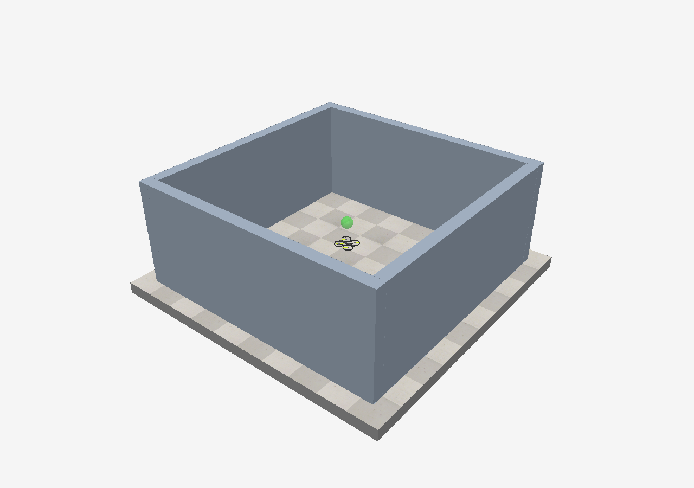
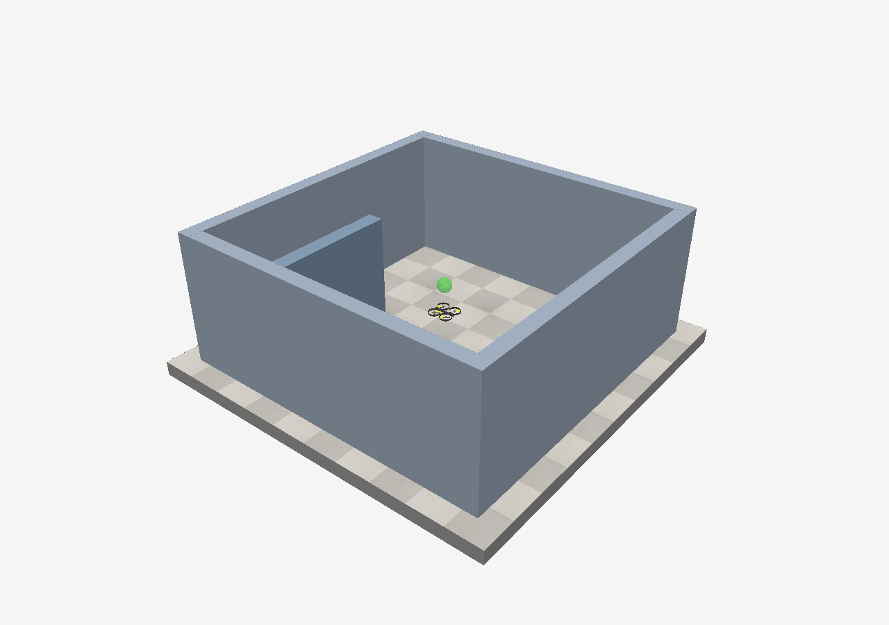
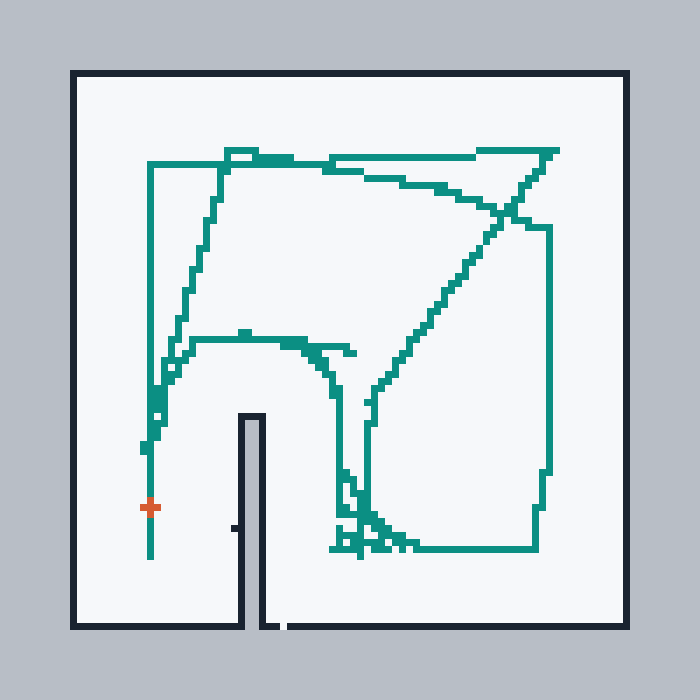

# Indoor Drone Mapping

A student project that flies CoppeliaSim's built-in Quadcopter through a simple 3D room and creates a **2D occupancy map from four short-range sensors**. We use Python for mapping and navigation while keeping the model's original stabilization controller.

We built this as a four-student college project. Our aim was to understand a complete sensing-to-movement workflow and make it possible for another student to reproduce it. This repository contains the **V1 submission**: source code, ready-to-open scenes, tests, example measurements and detailed explanations.



## What you can run

- A 4 m × 4 m room with actual simulated multirotor dynamics.
- Four ideal ray sensors, each limited to **1 metre**, on a simulated rotating bracket.
- A live map showing free space, occupied cells, unknown space and the flight path.
- Map-based navigation that prefers wall contours and then explores useful views of unknown interior areas.
- An empty room and an added-partition demonstration.
- Saved maps, telemetry and measured results.
- An offline analytic mode for studying the Python code without opening CoppeliaSim.

**Project scope:** this is known-pose mapping. Position and orientation come from the simulator. It is not SLAM or a finished physical drone. ESP-Drone is our proposed hardware direction; no onboard firmware integration is included.

## Contents

1. [Requirements and libraries](#requirements-and-libraries)
2. [Windows setup](#windows-setup)
3. [First simulation](#first-simulation)
4. [Added-wall demonstration](#added-wall-demonstration)
5. [Offline mode and tests](#offline-mode-and-tests)
6. [How the project works](#how-the-project-works)
7. [Settings](#settings)
8. [Files and outputs](#files-and-outputs)
9. [Recorded results](#recorded-results)
10. [Troubleshooting](#troubleshooting)
11. [Further reading and reuse](#further-reading-and-reuse)

## Requirements and libraries

| Requirement | Why we need it |
|---|---|
| Windows 10/11 | The supplied double-click launchers target Windows. |
| Python 3.10 or newer, with Tk support | Runs the mapper, navigation, scripts and live window. Python 3.12 is a suitable starting point. |
| CoppeliaSim Edu **4.10.0** and its standard model library | The release used for the recorded physics tests. Other releases are not verified. Install a simulator edition you are eligible to use. |
| Internet for initial installation | Downloads Python packages. The simulation can run locally afterward. |
| Git, optional | Cloning and contributing. GitHub's Download ZIP works too. |

Our development laptop had an Intel i5-12500H, 16 GB RAM and an NVIDIA RTX 3050. These are development-machine details, not measured minimum requirements. This project does not require Isaac Sim, ROS, CUDA, model training or a GPU Python framework.

### Python libraries

| Library/module | Installation | Use |
|---|---|---|
| `coppeliasim-zmqremoteapi-client==2.0.4` | In `requirements.txt` | Official Python ZeroMQ client. |
| `Pillow>=10` | In `requirements.txt` | Draw the occupancy image, display it through ImageTk and save PNG files. |
| `pyzmq` | Installed by the client; also pinned in the tested lock file | ZeroMQ transport and socket timeouts. `run.py` imports `zmq` directly. |
| `cbor` | Installed by the client | Message serialization used by the connector. |
| `tkinter` | Python installation, not pip | Live map window. On Linux this can be a separate OS package. |
| `math`, `heapq`, `collections`, `argparse`, `csv`, `json`, `pathlib`, `socket`, `subprocess`, `time`, `unittest` | Python standard library | Geometry, paths, file export, launching and tests. |
| Lua and CoppeliaSim's `sim` API | Provided by CoppeliaSim | Sensor callbacks and original flight controller. |

Use `requirements.txt` for the original dependency specification, or `requirements-lock.txt` for the exact package versions checked for this public package. A lock file records that environment; it does not promise that every future platform has compatible binary wheels.

## Windows setup

### 1. Download the project

On the GitHub repository page choose **Code → Download ZIP**, extract the ZIP and open the extracted folder. Alternatively:

```powershell
git clone https://github.com/bsakashbala/indoor-drone-mapping.git
cd indoor-drone-mapping
```

Work in the folder containing this README and `run.py`.

### 2. Install the simulator

Download CoppeliaSim from [Coppelia Robotics](https://www.coppeliarobotics.com/). The recorded runs used Edu 4.10.0 with the standard Quadcopter model at `models/robots/mobile/Quadcopter.ttm`. The simulator is a separate installation, not a pip package. Check its [licensing terms](https://manual.coppeliarobotics.com/en/licensing.htm) for your use.

### 3. Install Python

Install Python from [python.org](https://www.python.org/downloads/windows/), including Tcl/Tk and the Python launcher. In PowerShell check:

```powershell
py -3 --version
py -3 -m tkinter
```

The second command should open a small Tk test window. Close that test window afterward.

### 4. Install the libraries

Double-click **Setup.cmd**, or use PowerShell in the project folder:

```powershell
py -3 -m venv .venv
.\.venv\Scripts\python.exe -m pip install -r requirements-lock.txt
.\.venv\Scripts\python.exe tools/check_environment.py
```

There is no need to activate the environment or change PowerShell's execution policy. Every command below explicitly selects the virtual-environment interpreter. `Setup.cmd` uses `requirements.txt`; the lock-file command above selects the checked package versions.

### 5. Open the supplied scene

Open CoppeliaSim, choose **File → Open scene**, and select `IndoorDroneMapping.ttt` from this folder. Leave the simulation **stopped**. Use one simulator instance on port **23000**. Its ZeroMQ remote API server add-on must be enabled, as in a standard installation.

## First simulation

1. Save any unrelated simulator work and open `IndoorDroneMapping.ttt`.
2. Leave it stopped, then double-click **Start Project.cmd**.
3. Python starts the simulation and opens a separate live map window.
4. Let the initial sensor sweep finish. The drone then selects observation points and moves gradually.
5. Watch the map: **dark = occupied, white = observed free, gray = unknown, teal = flight path**.
6. At completion the simulation stops and the map window stays open. Close it to exit.
7. Open `output/coppeliasim/map.png` and `metrics.json` to inspect the result.

Manual launch:

```powershell
.\.venv\Scripts\python.exe launch.py
```

`launch.py` can start the simulator automatically from its normal Windows installation path. For another location, either open the simulator yourself or set its installation folder first:

```powershell
$env:COPPELIASIM_ROOT = 'D:\Applications\CoppeliaSimEdu'
.\.venv\Scripts\python.exe launch.py
```

Pressing CoppeliaSim's Play button alone runs the built-in flight controller. It does **not** run our external Python navigation. Start Python while the simulation is stopped.

The live display paces approximately to simulated time. The default limit is **900 simulated seconds**. A timeout or interruption means an incomplete run, not successful coverage. Repeated default runs replace `output/coppeliasim`; select a new output folder if you want to keep an experiment:

```powershell
.\.venv\Scripts\python.exe run.py --output output/my-first-run
```

## Added-wall demonstration

For the supplied example, stop the simulation and open **IndoorDroneMapping_ObstacleDemo.ttt**, then run **Start Project.cmd** again. Python uses the open project scene and preserves its partition.



To add your own wall:

1. Stop the simulation and save a copy of your scene.
2. Insert a cuboid inside the room and make it **static** and **respondable** in its dynamics properties.
3. Make it tall enough to intersect the sensor slice near 0.9 m flight height. For example, a 1.8 m wall centred at Z = 0.9 m spans that height.
4. Leave enough clearance for the drone. The nominal centre-to-occupied-cell planning margin is 0.52 m on each side.
5. Run Python again. Startup configures added shapes for sensing while excluding the drone, target, floor and reference objects.

The sensor stops at the first detected surface and never measures beyond one metre. A partition therefore hides the space behind it until the drone obtains a different view. This does not guarantee a successful survey of every arrangement: sealed rooms, narrow passages and difficult occlusions can remain unknown.

## Offline mode and tests

No simulator is required for these commands after installing the Python packages:

```powershell
.\.venv\Scripts\python.exe -m unittest discover -s tests -v
.\.venv\Scripts\python.exe run.py --offline --no-gui --layout empty
.\.venv\Scripts\python.exe run.py --offline --no-gui --layout partition --output output/offline-partition
.\.venv\Scripts\python.exe tools/validate_recorded_runs.py
```

Offline mode uses analytic ray intersections and simple kinematic motion. It exercises mapping and exploration but does **not** simulate a flying drone's dynamics. Keep its results separate from physics results.

To run the physics experiment without the map window, open either project scene in CoppeliaSim and leave it stopped, then use:

```powershell
.\.venv\Scripts\python.exe run.py --no-gui --output output/physics-empty
```

`--no-gui` disables our Tk map window; it does not itself close or hide CoppeliaSim. Use `--port 23001` only if you have separately configured a simulator server on that port. `--layout` selects offline geometry only; it does not switch the live simulator scene.

The [GitHub Actions workflow](.github/workflows/tests.yml) checks unit tests and committed evidence without installing CoppeliaSim.

## How the project works

1. **Build the environment.** `scene.py` creates four walls and loads CoppeliaSim's installed Quadcopter. It adds four ray sensors and our Lua telemetry extension.
2. **Stabilize the drone.** The original controller handles thrust and attitude while following a target object. We command target positions rather than individual motors.
3. **Sense nearby surfaces.** Four rays sweep the surroundings on a rotating bracket. Lua returns the measured drone pose, ray origins, hit endpoints and hit flags.
4. **Update the map.** Python converts world positions into grid cells. Bresenham traversal marks the measured ray path as free evidence and a detected endpoint as occupied evidence. Unobserved cells remain unknown.
5. **Plan with clearance.** Occupied cells are expanded by a margin and the whole body footprint must fit in observed free space. Dijkstra search finds reachable safe routes without cutting diagonal corners.
6. **Choose useful views.** The planner estimates how much unknown interior a short-range sweep might reveal. It favours views beside measured walls, then seeks views of remaining gaps.
7. **Move and recheck.** Python changes the target gradually, revises routes as observations arrive and retreats from a very close hit. A planned viewpoint counts as visited only after arrival and scanning.
8. **Finish and export.** Exhausting useful sampled reachable viewpoints ends the run. Separate contact, tilt and flight-bound monitors can stop a failed run and save partial evidence.

The planner receives the sensed occupancy map and pose. It does not receive the obstacle rectangles used by the scene builder or the evaluator. The configured outer work area is known in advance. See [ARCHITECTURE.md](docs/ARCHITECTURE.md) for module-level details, equations and the control loop.

## Settings

| Setting | Current value | File |
|---|---|---|
| Room interior | 4 m × 4 m | `scene.py`; matching search extent in `navigation.py` |
| Wall height/thickness | 1.8 m / 0.2 m | `scene.py` |
| Flight target height | 0.9 m | `navigation.py`, plus scene initial target |
| Maximum ray range | 1 m | `sensor_config.py` |
| Grid | 100 × 100, 0.05 m cells, 5 m × 5 m extent | `mapping.py` |
| Cruise target speed | Up to 0.12 m/s | `navigation.py` |
| Body footprint radius | 0.23 m | `navigation.py` |
| Occupied-cell planning margin | 0.52 m from drone centre | `navigation.py` |
| Close-hit retreat trigger | Below 0.40 m | `navigation.py` |
| Initial scan / viewpoint scan | 8 s / 2.8 s | `navigation.py` |
| Physics time step | 0.05 s | `scene.py` |
| Default run limit | 900 s simulated time | `run.py --max-seconds` |

Changing a Python constant does not automatically change a sensor embedded in a saved scene. Rebuild after changing sensor range or sensor mounting. If you change room size, update the scene, work-area extent, map extent and evaluation assumptions together.

### Optional scene rebuild

The supplied `.ttt` files are ready to run. To reproduce the empty scene from source, save unrelated work, open **File → New scene**, leave the simulator stopped, then run:

```powershell
.\.venv\Scripts\python.exe run.py --build
```

This loads the installed Quadcopter model and saves a new `IndoorDroneMapping.ttt`, replacing that generated project file. Keep a copy of an edited scene first. The builder refuses a scene already containing a Quadcopter or `IndoorMappingRoom`. Build only in a fresh scene: this check does not guarantee that every unrelated scene is empty.

## Files and outputs

```text
indoor-drone-mapping/
  README.md                       Start here
  LICENSE                         MIT terms for our original contribution
  THIRD_PARTY_NOTICES.md           Simulator/model/library attribution
  requirements.txt                Original dependency specification
  requirements-lock.txt           Exact packages checked for this package
  Setup.cmd / Start Project.cmd   Windows setup and launch
  Run Mapping.cmd                Start Python with an already-open simulator
  Build Scene.cmd                Optional scene-builder launcher
  IndoorDroneMapping.ttt          Empty-room scene
  IndoorDroneMapping_ObstacleDemo.ttt  Partition scene
  launch.py                      Find/start simulator on Windows
  scene.py                       Scene construction and Lua telemetry
  sensor_config.py               Shared range constant
  mapping.py                     Occupancy grid and map export
  navigation.py                  Safe paths and coverage viewpoints
  run.py                         Simulation loop, display and telemetry
  mission.py                     Legacy sensor-test reference route
  tests/                         Unit tests
  tools/                         Environment, evidence and package utilities
  examples/recorded_runs/         Original empty/partition physics evidence
  docs/                          Architecture, guide, Q&A and transcript
  reports/                       Detailed editable project report
  .github/workflows/tests.yml     Automated test workflow
  output/                        New results, created at runtime and ignored by Git
```

| Output file | Meaning |
|---|---|
| `map.png` | Human-readable map with recorded flight path. |
| `map.pgm` + `map.yaml` | Occupancy image, origin and resolution without the flight path. ROS-style export does not imply a ROS runtime dependency. |
| `grid.json` | Raw states: `-1` unknown, `0` free, `1` occupied. Rows increase with world Y. |
| `telemetry.csv` | Pose, ray origin/end, hit/range, target, phase and clearance measurements. |
| `metrics.json` | Completion, failure information and measured run statistics. Check `completed` and `failure`, not only the image. |

## Recorded results

These are **previously recorded CoppeliaSim 4.10.0 physics runs**, not results invented for the README or new hardware measurements. Raw files are committed in [examples/recorded_runs](examples/recorded_runs), and the evaluator can recompute the range and interior-coverage checks.

| Recorded metric | Empty room | Added partition |
|---|---:|---:|
| Simulated time | 182.75 s | 422.50 s |
| Range readings | 14,620 | 33,800 |
| Contact events | 0 | 0 |
| Minimum monitored surface clearance | 0.343 m | 0.302 m |
| Evaluated open-interior cells | 5,776 | 5,596 |
| Unknown cells in that evaluation region | 0 | 0 |
| Maximum recorded range | 1.0 m | 1.0 m |



The open-interior evaluation excludes a **10 cm outer-wall band** and a **5 cm surface band around the partition**. Gray exterior and solid interiors are not counted as missing free-space coverage. Zero unknown cells refers only to that evaluation region. These two static tests do not prove collision-free or complete exploration in every room. The original baseline recorded 17 passing unit tests; any added packaging tests are reported separately in [REPRODUCIBILITY.md](docs/REPRODUCIBILITY.md).

## Troubleshooting

| Problem | What to check |
|---|---|
| `py` is not recognized | Install the Python launcher, or substitute your installed Python executable in the setup commands. |
| `No module named PIL` or missing connector | Run pip with `.venv\Scripts\python.exe`, using the requirements file, then run the environment checker. |
| Tk window does not open | Try `py -3 -m tkinter`; install Python with Tcl/Tk, or use `--no-gui`. |
| Cannot connect to localhost:23000 | Open CoppeliaSim, enable its ZMQ server add-on, check the port and close extra simulator instances. |
| Wrong scene or missing `IndoorMappingRoom` | Open the supplied project `.ttt`; Python deliberately refuses unrelated scenes. |
| Simulation is already running | Stop it, then launch Python. |
| Drone only hovers | Start Python; pressing Play alone does not run exploration. |
| Added wall seems invisible | Ensure it is a scene shape, detectable, static/respondable and intersects the flight-height slice. Restart from a stopped scene. |
| Sensor range configuration differs | Rebuild the scene after changing the shared range constant. |
| Missing Quadcopter model | Install the standard library for the tested simulator version. The builder expects the path shown above. |
| Gray patches remain | Inspect reachability, clearance and occlusion. Never label unobserved areas free just to make the map look complete. |
| Run stops early | Read `metrics.json` and telemetry. Contact, tilt, altitude, bounds, a time limit or a user interruption can stop a run. |
| Optional simulator Python add-on reports `cbor`/`cbor2` | Our connector runs in the external project environment. Optional embedded-Python add-ons use a separate environment; configure them only if needed. |

## Further reading and reuse

- [Step-by-step student build guide](docs/BUILD_GUIDE.md)
- [Architecture, algorithms and data formats](docs/ARCHITECTURE.md)
- [Verification and reproducibility](docs/REPRODUCIBILITY.md)
- [Four-student presentation and viva guide](docs/TEAM_AND_VIVA.md)
- [Professionally rewritten project conversation](docs/PROJECT_CONVERSATION.md)
- [Full project conversation transcript, sanitized for publication](docs/CONVERSATION_TRANSCRIPT.md)
- [Detailed editable project report](reports/Project_Report.md)
- [Contribution guide](CONTRIBUTING.md)
- [Publishing instructions](docs/PUBLISHING.md)

Our team presentation lists **Bhavesh Sharma, Priyanshu Yadav, Atharva Joshi and Akash Bala**. The suggested explanation split is documented separately; it is not an invented record of individual code contributions. AI assistance was used during development and documentation; the conversation records that process. Students reproducing the project should read the code, run the tests and understand the limits before presenting it as their work.

Our original code and documentation use the [MIT license](LICENSE). The built-in drone/controller and simulator remain attributed to Coppelia Robotics under their upstream terms. See [third-party notices](THIRD_PARTY_NOTICES.md). Do not interpret a public repository as a change to CoppeliaSim Edu's eligibility or commercial-use rules.

Official references: [ZeroMQ API](https://manual.coppeliarobotics.com/en/zmqRemoteApiOverview.htm), [proximity sensors](https://manual.coppeliarobotics.com/en/proximitySensors.htm), [model library](https://github.com/CoppeliaRobotics/models/tree/master/robots/mobile), [ESP-Drone hardware reference](https://github.com/espressif/esp-drone).
