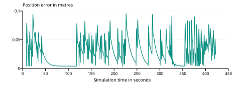

# Indoor Drone Mapping Using CoppeliaSim

## Project report

Prepared for a four-member college project team. Implementation and simulation validation dated 19 October 2026.

## Abstract

This project demonstrates how a quadcopter flying inside a room can produce a two-dimensional occupancy map. A simple CoppeliaSim scene contains a room with an optional partition, its built-in Quadcopter model and four short-range swept rays. An external Python application selects wall-adjacent viewpoints and interior coverage goals from the measured map, reads actual sensor poses and distances, and exports the map and telemetry. The existing simulator flight controller remains responsible for stabilization.

The revised demonstration completed a 422.5-second sensor-driven survey with an added partition wall in CoppeliaSim Edu 4.10.0. It recorded 33,800 one-metre range measurements, with zero contact events and a minimum measured body-to-wall gap of 0.302 m. Validation found zero unknown cells in the evaluated open interior. The system uses exact simulator pose, a known 4 m square work area and ideal swept rays. These results demonstrate bounded active coverage with static obstacles; they do not validate hardware flight or onboard localization.

Figure 1. Rendered partition demonstration in its stopped initial state. The green sphere is the target followed by the built-in flight controller.

<!-- pagebreak -->

## 1 Project purpose and scope

The team's overall goal is an indoor drone capable of observing a room and producing a useful 2D representation. Indoor work needs a position source other than an assumed outdoor GPS fix. It also needs stable flight, trustworthy distance readings and a mapping method that distinguishes observed free space from areas that have not been seen.

The first deliverable deliberately isolates the mapping task. It uses a small simulated room and a supplied flight controller, allowing the team to investigate coordinate transformations, occupancy updates and data collection without first designing an aircraft. The simulation is three dimensional, while the map describes the horizontal plane intersected by the range sensors.

### Objectives

- Build a repeatable 3D simulation using the installed drone model.
- Follow sensed wall contours and survey remaining gaps while preserving multirotor dynamics.
- Obtain four distance measurements and actual pose at regular intervals.
- Construct a 2D occupancy grid from measured rays rather than copying scene geometry.
- Display and export the map, preserve telemetry and measure defined performance indicators.
- Document a staged path towards an ESP-Drone hardware prototype.

| Requirement | Implemented scope |
|---|---|
| Environment | A 4 m by 4 m room with optional added walls |
| Robot | One built-in CoppeliaSim Quadcopter |
| Motion | Wall contour preference and active coverage viewpoints |
| Sensing | Four swept ideal rays with 1 m maximum range |
| Position | Exact simulator pose |
| Map | 100 by 100 grid with 0.05 m cells |
| Hardware | Proposed integration plan only |

This revision adds obstacle-aware navigation to the known-pose mapper. The planner favors wall contours, uses only sensed free space for paths, and selects viewpoints for remaining unknown regions. The 4 m square work area is configured in advance; obstacle locations are learned from rays. SLAM and a hardware-ready autopilot remain outside the implemented scope.

<!-- pagebreak -->

## 2 System architecture

CoppeliaSim performs the physical simulation and range detection. Its existing drone script converts target errors into forces and torques. Python supplies target positions and headings, then reads one synchronized telemetry packet. The mapping module is independent of CoppeliaSim and receives only ray origins, ray endpoints and hit flags.

### Information flow

Measured map and pose -> Safe footprint and path search -> Target command -> Built-in controller -> Drone dynamics

Drone dynamics -> Actual sensor transforms and wall detections -> Telemetry packet -> Occupancy grid -> Live display and exports

This separation prevents the mapper from using the commanded target as if it were the drone's measured position. Actual flight lag remains visible in the trajectory and tracking error. A short Lua telemetry function is appended to the built-in controller; the original stabilization logic is retained. Decorative particle generation is disabled to reduce unnecessary work, while the original thrust calculation is preserved.

| Module | Responsibility |
|---|---|
| scene.py | Build walls, load model, attach sensors and save the scene |
| navigation.py | Select wall contour and coverage goals with clearance |
| run.py | Coordinate simulation steps, telemetry, display and export |
| mapping.py | Apply occupancy updates and serialize the grid |
| launch.py | Locate the simulator and start the supplied demonstration |

Python communicates through the official ZeroMQ Remote API [1]. Stepping mode keeps target changes and sensor readings aligned with simulation advancement. The simulation time step is 0.05 s. A mapping packet is read each step, with four one-metre rays in each packet. A simulated rotating sensor bracket sweeps at 0.65 rad/s while the drone keeps a stable heading. Simulation time is the basis of mission timing. Wall-clock runtime depends on rendering, processor load and whether live pacing is enabled.

The implementation requires no ROS installation, neural network, GPU training framework or external drone asset download. The ready-made scene contains the model and controller needed for the demonstration.

<!-- pagebreak -->

## 3 Simulation environment and sensor arrangement

The room interior extends from -2 m to +2 m along both horizontal axes. Four cuboid walls are 0.2 m thick and 1.8 m high. The ceiling is omitted to keep the drone visible. Walls are static, respondable and detectable. Primitive shapes provide a simple environment for physics and range detection [2]. The existing default floor remains in place.

| Wall | Dimensions X Y Z in m | Centre X Y Z in m |
|---|---|---|
| North | 4.4  0.2  1.8 | 0  2.1  0.9 |
| South | 4.4  0.2  1.8 | 0  -2.1  0.9 |
| East | 0.2  4.4  1.8 | 2.1  0  0.9 |
| West | 0.2  4.4  1.8 | -2.1  0  0.9 |

Four sensors are children of the drone's physical base reference. Their directions are front, left, back and right in body coordinates. Each sensor is limited to 1 m: a wall farther away cannot produce a detection, and the mapper does not clear space beyond that limit. Each sensor uses its local positive Z axis for detection; the builder constructs an explicit orientation matrix to point it horizontally. The mounting height is 0.04 m above the base reference.

The sensing collection includes scene shapes, including a new wall added by the user. The drone, its target, floor, cameras and reference dummies are excluded. The script rotates and explicitly handles the sensors during each sensing callback, then the telemetry function reads their results [3]. If a wall is detected, its local hit point is transformed into world coordinates. Otherwise, the ray ends at the maximum range and clears observed space without inventing a wall at that distance.

This sensor arrangement is a simulation design choice. A physical aircraft would need to carry the equivalent modules, power supply and wiring. The baseline deliberately omits measurement noise, field-of-view effects, reflectivity, multipath and dropout. A ray is a geometric approximation to a real sensor, not a validated model of a particular time-of-flight product.

<!-- pagebreak -->

## 4 Wall following and coverage navigation

The built-in quadcopter and its stabilization controller are retained and credited to Coppelia Robotics [4]. The old fixed square route is no longer used in live operation. navigation.py receives the measured occupancy grid and drone pose; it does not receive the scene's obstacle geometry.

After the initial eight-second hover and sensing period, the planner identifies known free cells. Measured occupied cells are inflated by 0.52 m from the drone centre, including its body radius and controller braking margin. Unknown space is also excluded from the full 0.23 m body footprint. This prevents planning a centreline that fits while the rotors overlap an obstacle or unseen space.

Dijkstra search finds reachable viewpoints through the resulting safe cells, with diagonal corner cutting prohibited. Candidate viewpoints are sampled on a 0.15 m lattice. A visibility-gain calculation estimates how much unknown interior space a one-metre sweep could observe. Viewpoints 0.52 to 0.62 m from a measured obstacle receive a preference, producing wall-contour following before views of remaining interior gaps.

| Phase | Behaviour |
|---|---|
| Initial scan | Hover and observe nearby space |
| Wall contour | Prefer safe viewpoints beside sensed walls |
| Interior coverage | Move to views that expose remaining unknown cells |
| Replan or retreat | Cancel an unsafe route and hold or move away |
| Finish | Stop after useful reachable viewpoints are exhausted |

Target movement is limited to 0.12 m/s with at most 0.10 m of lead over measured position. The path is rechecked as observations arrive. A ray hit closer than 0.40 m triggers a fixed retreat target rather than repeatedly moving the target with a drifting drone. A viewpoint counts as visited only after arrival and a 2.8 s sweep. This avoids incorrectly declaring an aborted plan surveyed.

The configured coverage work area is 4 m by 4 m. The algorithm does not chase unknown exterior pixels through small gaps in a rasterized wall. It never changes an unseen cell to free merely to remove a gray patch. Solid wall interiors, sealed regions and inaccessible passages can remain unknown. Geometry-based contact and clearance checks are separate validation monitors, not navigation inputs. The simulation stops on contact, excessive tilt, altitude failure or the time limit.

<!-- pagebreak -->

## 5 Mapping method

The map covers a 5 m by 5 m area centred at the world origin. A resolution of 0.05 m produces 100 columns and 100 rows. Every cell begins unknown. World coordinates are converted to cell indices using floor((x + 2.5) / 0.05) and floor((y + 2.5) / 0.05). Bounds checks prevent writing outside the grid.

For each reading, let o be the sensor's actual world position. Let R be its world rotation and q the local hit point. A detected endpoint is computed as p = o + Rq. CoppeliaSim's transform utility performs this operation in the telemetry function. For a missed wall, q = [0, 0, 1] describes the end of the maximum-range ray. The map uses the horizontal coordinates of o and p. Small drone tilts therefore affect the projected distance correctly rather than being ignored.

Bresenham traversal enumerates the grid cells crossed by the segment. Cells before a detected endpoint receive free-space evidence. The endpoint receives occupied evidence. A no-return ray marks only free-space evidence along its extent. Cells that have never been observed remain unknown. This distinction matters when exporting a map for later navigation.

### Evidence update

L_new = clip(L_old + delta, -4, +4)

The occupied endpoint increment is +0.85; a traversed free cell receives -0.4. These are tunable evidence weights rather than calibrated probabilities from a real sensor. A cell is displayed occupied when L > 0.6, free when L < -0.2 and unknown otherwise. An explicit observed flag prevents an untouched zero value from becoming free space.

Clamping prevents repeated measurements from producing unlimited confidence. Repeated negative evidence can eventually clear a previously occupied cell. The grid is a simplified log-odds style inverse sensor model; its classification thresholds are demonstration choices and should be recalibrated for measured sensor errors before hardware use.

The preview uses dark cells for occupied space, white for free space and gray for unknown space. A teal line shows the measured flight path and an orange marker indicates its final position. Those annotations appear only in the PNG preview. The PGM occupancy image contains no trajectory overlay and is accompanied by a YAML file describing scale and origin.

<!-- pagebreak -->

## 6 Installation and operation

The supplied scene is ready to open. On the project computer, save unrelated CoppeliaSim work and double-click Start Project.cmd. The launcher uses the project virtual environment created by Setup.cmd. If no simulator is running, it starts the installed CoppeliaSim with IndoorDroneMapping.ttt. If a different scene is already open, the runner refuses to replace it.

For another Windows computer, install CoppeliaSim Edu and Python 3.10 or newer with Tk support. Run Setup.cmd once with internet access to create a virtual environment and install the Python connector and Pillow. Then use Start Project.cmd. The project was tested against CoppeliaSim Edu 4.10.0; other releases may require adjustments to model paths or APIs.

### Demonstration procedure

1. Load IndoorDroneMapping.ttt and leave the simulation stopped.
2. Start the Python launcher. Do not press Play manually first.
3. Observe the drone in the 3D view and the evolving 2D map window.
4. Allow several minutes of simulated survey time. The default limit is 900 s.
5. Inspect map.png, telemetry.csv and metrics.json in output/coppeliasim.
6. Close the map window after the run. Reload the supplied scene if it was edited.

Python normally controls simulation advancement and paces live operation approximately to simulated time. Closing the map window requests termination, and the runner stops the simulator and saves partial results. A headless mapping run uses the --no-gui option and may complete faster than real time. The --offline option exercises the same mapper with analytic rays, without aircraft physics, and writes to a separate output folder.

### Rebuilding and recovery

To add a wall, stop the simulation, insert a static respondable cuboid, and start Python again. Startup upgrades the script in memory and includes the added geometry while preserving the open scene. IndoorDroneMapping_ObstacleDemo.ttt supplies the validated partition example. Rebuilding is optional: save existing work, open File > New scene, then run Build Scene.cmd. The builder adds all walls and sensors automatically and saves the generated scene. It refuses to build over an existing quadcopter or project room. A connection failure usually indicates that CoppeliaSim is closed, the ZMQ server add-on is disabled or another instance is using port 23000. A full procedure and troubleshooting guide are included in README.md.

<!-- pagebreak -->

## 7 Measured simulation results

The final partition run used the built-in drone dynamics in CoppeliaSim Edu 4.10.0. It completed active coverage without contact. The body-clearance measurement comes from physical scene shapes; reference dummies and the target are excluded. The results table is generated from saved telemetry and metrics.

| Metric | Recorded value |
|---|---|
| Simulator version | CoppeliaSim Edu 4.10.0 |
| Mission completion | Completed |
| Simulated mission time | 422.5 s |
| Range readings | 33800 |
| Grid resolution | 0.05 m |
| Sensor maximum range | 1.0 m |
| Position tracking RMS after settling | 0.036 m |
| Observed altitude range | 0.502 to 0.896 m |
| Occupied cells | 376 |
| Free cells | 5964 |
| Wall recall with one cell tolerance | 100.0% |
| Contact events | 0 |
| Minimum body surface clearance | 0.302 m |

Figure 2. Position tracking error relative to the continuous target, calculated from recorded simulator poses. The initial settling interval is excluded from the RMS calculation. Targets are the actual navigation commands recorded in the CSV.

Perimeter recall evaluates 636 boundary cells. A cell counts as detected when occupied evidence exists within a one-cell neighbourhood. This tolerance allows grid discretization effects; it does not measure false positives, localization robustness or overall map accuracy.

A separate grid check evaluates the open interior, excluding a 0.10 m band at outer walls and a 0.05 m band around the partition. Both empty-room and partition runs recorded zero unknown cells in that evaluated area and zero contact events. Cells inside the solid partition or outside the room are not counted as free space. These results concern the tested static layouts and exact simulator pose, not arbitrary layouts or hardware accuracy.

<!-- pagebreak -->

## 8 Generated occupancy map

Figure 3. Actual map output from the completed mission. The full image covers 5 m by 5 m. World X increases to the right; world Y increases upward. The room interior is 4 m by 4 m and the cell size is 0.05 m.

The dark perimeter corresponds to measured wall hits gathered only after the drone moves within 1 m. Gray regions remain unknown until a sensor ray reaches them. Gaps in the perimeter are expected with a short-range, sparse-ray demonstration. Boundary thickness reflects grid quantization and accumulation of competing evidence. A distant wall is never copied into the map simply because its location is known to the scene builder.

The teal trajectory is based on actual drone positions, so its rounded corners and offset from the reference are expected. This image is a visualization; map.pgm and map.yaml are the occupancy export for downstream tools. The illustrated scene includes the added partition. A separate empty-room run is retained as a regression check. The result is a bounded static-obstacle coverage demonstration.

<!-- pagebreak -->

## 9 Verification and reproducibility

Validation has three layers: automated mapping and planner checks, an analytic kinematic experiment, and CoppeliaSim flights with actual drone dynamics. Analytic results are stored separately and are not presented as flight evidence. Seventeen automated checks passed, including range limits, unknown-space handling, collision-inflated paths, fixed retreat commands and preservation of unrelated running simulations.

| Physics test | Empty room | Added partition |
|---|---|---|
| Mission completion | Completed | Completed |
| Contact events | 0 | 0 |
| Minimum surface gap in m | 0.343 | 0.302 |
| Unknown evaluated interior cells | 0 | 0 |
| Simulated duration in s | 182.8 | 422.5 |

The added wall is a 0.20 m thick partition, extending from the south wall to Y = -0.45 m, centred at X = -0.70 m. It is inserted as an ordinary scene cuboid. The planner receives no rectangle coordinates; its route is based on sensor hits. Only the separate test evaluator uses that geometry to distinguish open interior from solid wall space.

The tests check that paths go around a partition with clearance, unknown patches create sensing goals without being filled artificially, an unobserved corridor narrower than the drone blocks movement, and an emergency retreat target stays fixed while the measured position changes. A planned goal must not be counted as visited before arrival.

Run python -m unittest discover -s tests -v for automated checks. Run python run.py --offline --no-gui --layout partition for the analytic example, or python run.py --no-gui with either supplied scene open and stopped for a physics run. Geometry monitors stop contact; they are not part of the planner's map or visibility gain.

CSV rows include actual pose, ray origin, endpoint, range, hit flag, target command, clearance and phase. metrics.json records completion, contact count and navigation plans. examples/recorded_runs/summary.json preserves both tested cases. Completion means exhaustion of useful sampled reachable viewpoints inside the configured work area; it is not a proof of coverage for every possible scene.

<!-- pagebreak -->

## 10 Proposed ESP Drone hardware integration

The hardware direction remains Espressif's ESP-Drone project [5]. It provides an ESP32-family flight-control reference and uses ESP-IDF firmware. The simulation does not execute that firmware, and the built-in CoppeliaSim drone is not a calibrated digital twin of a particular ESP-Drone build. Transferring a successful simulation requires an input adapter, suitable sensors, stable flight and a position source.

Keep time-critical stabilization and motor control on the flight controller. Run the occupancy mapper on a laptop initially. Send timestamped range readings and pose estimates over Wi-Fi; use documented units, sensor identity and validity flags. Network delay must not become part of the stabilization loop. The mapping module can accept this new data source while retaining its grid update logic.

### Position and height

The simulator supplies exact pose for free; the aircraft will not have that information automatically. Accelerometer integration alone is not a practical replacement because errors accumulate. A possible low-cost first demonstration is a borrowed overhead camera tracking a printed marker, with camera calibration and an unobstructed view. Optical flow with a downward range sensor is another direction, but still needs appropriate estimation and heading treatment. ESP-Drone's documented position-hold extension uses optical flow and downward ranging [6].

### Staged hardware work

1. Reproduce the reference firmware build and confirm supported board configuration.
2. Test the IMU, motor outputs and power system on the bench with propellers removed.
3. Obtain stable manually controlled flight using a lightweight guarded frame.
4. Test a horizontal sensor on the bench and stream its readings to the laptop.
5. Establish a measured position source and align its world frame with the mapping frame.
6. Collect mapping data during supervised flight before attempting automated commands.

Four simulated sensors are not a compulsory first hardware purchase. A single sensor can be scanned by changing heading, but obtaining heading, pose and safe control during the scan remains necessary. Board-level compatibility, motor thrust, payload, battery current, sensor interference and firmware timing must be checked before selecting components. Hardware assembly, flight endurance and map accuracy have not been measured in this deliverable.

<!-- pagebreak -->

## 11 Budget and team plan

The stated team budget is assumed to be INR 500 to 1,000 per member, giving INR 2,000 to 4,000 total. The simulation reuses the existing laptop and educational simulator installation. A complete, stable flying mapper has not been costed within that limit. The following amounts are spending ceilings for planning, not current supplier quotations or a validated bill of materials.

| Budget category | Planning ceiling in INR |
|---|---:|
| Controller electronics and IMU | 800 |
| Motors propellers and frame | 1000 |
| Battery charging and connectors | 650 |
| Initial range sensor allowance | 450 |
| Wiring guards and mounting | 300 |
| Shipping spares and reserve | 800 |
| Total maximum allocation | 4000 |

The table does not guarantee that the required parts are available at these amounts. It does not include a purchased tracking camera, optical-flow extension or additional range sensors. Obtain supplier quotes and measure the expected aircraft mass before committing to purchases. If costs exceed the cap, prioritize the simulation and a bench sensing demonstrator, while borrowing flight or tracking equipment from the college.

| Member | Suggested ownership |
|---|---|
| 1 | Python mapping and telemetry |
| 2 | CoppeliaSim scene and flight experiments |
| 3 | Electronics and ESP-Drone firmware |
| 4 | Validation data report and demonstration |

### Suggested next four working weeks

Week 1: reproduce the supplied simulation and explain each module. Week 2: add one controlled change, such as measurement noise, and compare against the baseline. Week 3: verify firmware compatibility, obtain quotes and bench-test available sensors. Week 4: consolidate the report, record the demonstration and attempt supervised hardware integration only if stable flight and tracking are available. This is a proposed work sequence, not a claim that the hardware is already completed.

<!-- pagebreak -->

## 12 Limitations and further development

The largest limitation is exact pose. This project performs mapping given position and orientation; it does not jointly estimate those quantities and a map. Replacing exact pose with noisy odometry or camera tracking is necessary before evaluating the localization problem. SLAM should be claimed only after an implemented estimator is tested under appropriate conditions.

The obstacle route is now selected from the sensed map, but the outer work area remains configured as a 4 m square. The tests cover static walls, adequate gaps and exact pose. They do not establish safe flight around rapidly moving objects, transparent surfaces, arbitrary narrow passages or obstacles inserted directly into the aircraft during flight. Viewpoint sampling and evidence thresholds can also miss difficult occlusions.

Sensors are ideal rays. A hardware model should introduce measured range bias, noise, detection probability, maximum range and update timing. Dropouts must remain distinct from valid no-return readings: missing data should not erase obstacles as free space. Multiple sensors also introduce addressing, synchronization, interference and mass constraints.

### Prioritized extensions

- Add configurable sensor noise and missing-data handling, then quantify map degradation.
- Replace simulator pose with a simulated camera estimate or noisy odometry input.
- Extend the validated static partition case to several layouts and controlled moving obstacles.
- Measure false occupied cells, free-space errors and boundary precision alongside recall.
- Calibrate a physical aircraft model using measured mass, thrust and inertia.
- Implement hardware telemetry, supervised mapping and a separate landing procedure.

### Questions for the project viva

How does the drone hug a wall? Known occupied cells are inflated, and safe wall-adjacent viewpoints are preferred. How are gray interior gaps handled? The planner moves to viewpoints that can observe them; it does not label them free without measurements. Why is the world 3D while the map is 2D? The sensors measure a horizontal slice at flight height. Why is this not SLAM? Pose comes from the simulator rather than being estimated jointly with the map. Why use actual pose rather than the target? The drone lags behind its command, and mapping must reflect where a reading was taken. What is unknown space? It is space without sufficient observation, and it must not automatically be treated as free. What is the team's contribution? Scene construction, sensor integration, mission, mapping, validation, visualization and documentation around an attributed existing drone model.

The completed simulation gives the team a working, explainable foundation for experiments. The hardware plan identifies the additional flight, sensing and localization work required to turn that foundation into a physical room-mapping drone.

<!-- pagebreak -->

## 13 References and deliverable inventory

The following official sources support the APIs, model provenance and hardware reference. Sources were checked on 19 October 2026. Local telemetry and metrics provide the evidence for the numerical results in this report.

[1] Coppelia Robotics. ZeroMQ remote API. https://manual.coppeliarobotics.com/en/zmqRemoteApiOverview.htm

[2] Coppelia Robotics. Shapes and shape dynamics. https://manual.coppeliarobotics.com/en/shapes.htm and https://manual.coppeliarobotics.com/en/shapeDynamicsProperties.htm

[3] Coppelia Robotics. Proximity sensors and sensor reading API. https://manual.coppeliarobotics.com/en/proximitySensors.htm and https://manual.coppeliarobotics.com/en/sim/simReadProximitySensor.htm

[4] Coppelia Robotics. Official model collection including Quadcopter.ttm. https://github.com/CoppeliaRobotics/models/tree/master/robots/mobile

[5] Espressif Systems. ESP-Drone source repository and project requirements. https://github.com/espressif/esp-drone

[6] Espressif Systems. ESP-Drone getting started and sensor extension overview. https://docs.espressif.com/projects/espressif-esp-drone/en/latest/gettingstarted.html

### Deliverable inventory

IndoorDroneMapping.ttt is the ready-to-open simulation. Start Project.cmd and launch.py start the demonstration. Setup.cmd and requirements.txt support a fresh Python installation. Build Scene.cmd and scene.py reproduce the generated scene. The main application is run.py. navigation.py contains wall-contour preference, safe path search and coverage goals; mapping.py contains occupancy updates. sensor_config.py defines the 1 m range. The old mission.py reference is retained only for legacy sensor checks. The tests folder contains seventeen automated checks. A second scene demonstrates the added partition.

In this public package, examples/recorded_runs contains the original empty and partition physics runs and their summary. New runs create output/coppeliasim or output/offline locally; those generated folders are ignored by Git. This editable Markdown report and its figures are included. The original separately delivered academic PDF and slide deck are not runtime dependencies. The root README describes the portable setup and the additional public-package utilities.

### Attribution

The built-in quadcopter geometry and original stabilization controller belong to the Coppelia Robotics distribution. The project retains their provenance and makes no claim that those components were designed by the team. CoppeliaSim Edu and its assets remain subject to upstream terms. ESP-Drone is referenced for future hardware work and is not bundled or executed here. College-specific names, supervisor details and submission forms can be added by the team without inventing completed hardware work or changing the reported evidence.
